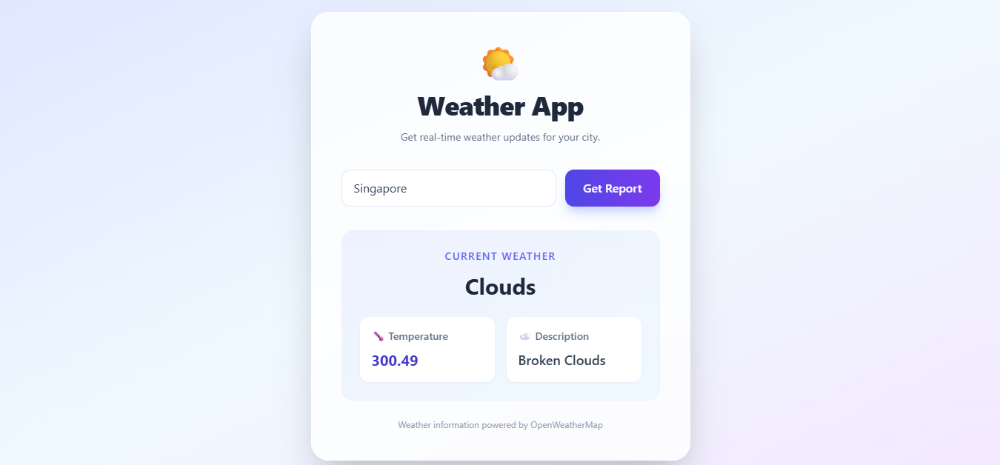

# 🌦️ Weather App

A responsive weather application built using React.js and the OpenWeatherMap API. It allows users to search for a city and view its weather information through a simple and user-friendly interface.

## 🌐 Live Demo

[](weather-app-inthu2.vercel.app)

## 📸 Screenshot

<p align="center">
  
</p>

## ✨ Features

- 🌍 **City Search:** Search for weather information by entering a city name.
- 🌡️ **Temperature Display:** Displays the temperature of the searched city.
- ☁️ **Weather Conditions:** Shows the current weather conditions.
- 📝 **Weather Description:** Displays a description of the weather.
- 🔄 **API Integration:** Fetches weather information using the OpenWeatherMap API and Axios.
- ⚛️ **State Management:** Uses React's `useState` hook to manage application state.
- 📱 **Responsive Design:** Adapts the interface to different screen sizes.

## 🛠️ Technologies Used

- ⚛️ React.js
- 📜 JavaScript
- 🔗 Axios
- 🎨 Tailwind CSS
- 🌤️ OpenWeatherMap API

## 🚀 Run Locally

1. Clone the repository:

   ```bash
   git clone https://github.com/inthusha20241647-commits/weather-app.git
   ```

2. Navigate to the project directory:

   ```bash
   cd weather-app
   ```

3. Install dependencies:

   ```bash
   npm install
   ```

4. Configure your OpenWeatherMap API key according to the environment variable expected by your application.

5. Start the development server:

   ```bash
   npm start
   ```

6. Open your browser at `http://localhost:3000`.

## 🎯 Learning Purpose

This project helped me practise:

- Fetching data from an external API.
- Making HTTP requests using Axios.
- Managing component state using React's `useState` hook.
- Displaying dynamic data in a React application.
- Styling components using Tailwind CSS.
- Handling user input for city-based searches.

---

*This project is part of my continuous learning journey in React and frontend development.*
