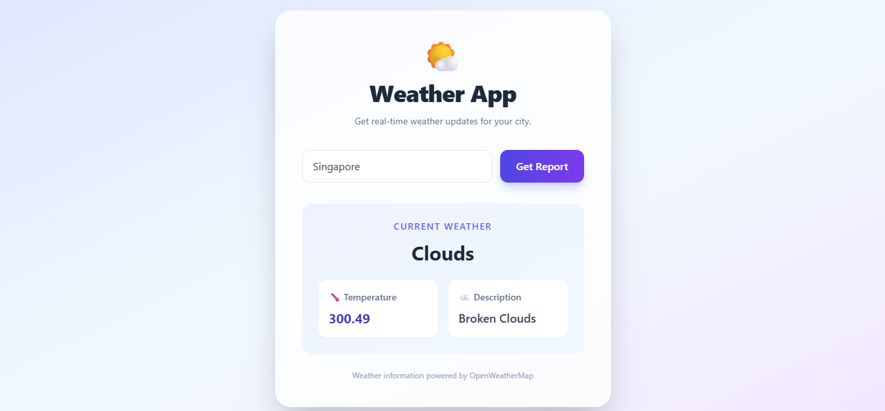

# 🌦️ Weather App

A simple and responsive weather application built with React.js and the OpenWeatherMap API.

## 📸 Screenshot

<p align="center">
  
</p>

## ✨ Features

- 🌍 Search for weather by city name
- 🌡️ Display temperature
- ☁️ Show current weather conditions
- 📝 Display weather descriptions
- 🔄 Fetch weather data using Axios
- ⚛️ Manage state using React's `useState` hook
- 📱 Responsive user interface


## 🛠️ Technologies Used

- React.js
- JavaScript
- Axios
- Tailwind CSS
- OpenWeatherMap API

## 🚀 Getting Started

1. Clone this repository.
2. Install dependencies:

   ```bash
   npm install
   ```

3. Start the development server:

   ```bash
   npm start
   ```

## 👩‍💻 Learning Purpose

This project helped me practise React state management, API integration, Axios, and displaying dynamic data in a user interface.
